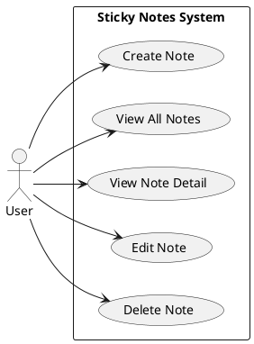
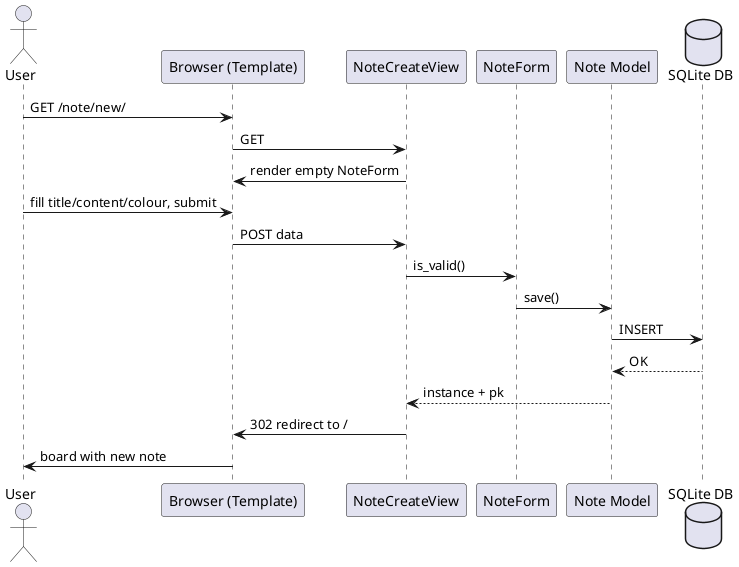
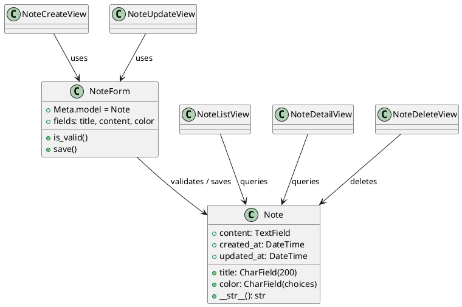

# Sticky Notes — Software Design

Bootcamp design artefacts (Step 1 of the project). PNG renders are in this
folder; PlantUML sources below can be pasted at https://www.plantuml.com/plantuml
if you need vector/UML-standard versions.

## 1. Use case diagram (`use_case_diagram.png`)

**Reading:** a single actor (User, no login required in this version) can do
full CRUD on the board. View All is the landing board page; Detail/Edit/Delete
all operate on a `Note pk`.

## 2. Sequence diagram (`sequence_diagram.png`) — Create Note

Edit follows the same flow with `NoteUpdateView` + `UPDATE`; Delete uses
`NoteDeleteView` (GET = confirm page, POST = `DELETE` + redirect);
List/Detail are GET-only (`SELECT` → render).

## 3. Class diagram (`class_diagram.png`)

**Design principles applied:** single-responsibility (Model = data, Form =
validation, CBVs = HTTP, Templates = presentation), DRY (one `base.html`,
one `NoteForm`, generic CBVs instead of repeated function views),
MVC/MVT separation, and explicit URL naming (`notes:note-list`, etc.).
